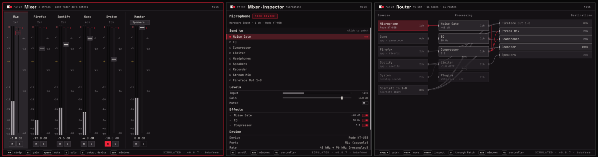

<p align="center">
  <a href="https://patchaudio.app"></a>
</p>

<p align="center">
  <a href="https://github.com/novuon/patch-releases/releases/latest"></a>
  <a href="https://github.com/novuon/patch-releases/releases"></a>
  <a href="https://patchaudio.app/download"></a>
  
  
  <a href="https://patchaudio.app"></a>
</p>

<p align="center">
  <a href="https://patchaudio.app"><b>Website</b></a> ·
  <a href="https://patchaudio.app/download"><b>Download</b></a> ·
  <a href="https://patchaudio.app/docs"><b>Documentation</b></a> ·
  <a href="https://github.com/novuon/patch-releases/releases"><b>Releases</b></a> ·
  <a href="https://github.com/novuon/patch-releases/issues/new?template=bug_report.yml"><b>Report a bug</b></a>
</p>

**Patch is the audio environment for Omarchy**, and it runs on other Linux distributions too. It becomes your system's sound: one real-time engine with a mixer, EQ, meters, routing, recording, DJ decks, a visualiser, and podcast and live-coding tools. The engine keeps playing when windows close or Patch updates.

<p align="center"></p>

## Install

```bash
curl -fsSL https://get.patchaudio.app | bash
```

The installer downloads the newest release, checks its SHA-256 and asks how you use Patch: Standard (your sound, the Mixer and the EQ), DJ, Podcast, Live coding, Everything or Custom. Updating is the same line, and keeps your setup, library and settings. Add or remove modules later with <kbd>Ctrl</kbd>+<kbd>K</kbd> › Setup › Modules.

Then log out and back in once (or restart). Patch works right away; real-time audio, which keeps the sound steady when the computer is busy, starts with your next login. The installer ends by reminding you.

**Installing with an AI agent?** An agent has no terminal for the setup screen, so a first install lists the setups and stops without changing anything. The agent asks you which one you want and runs it again, for example `curl -fsSL https://get.patchaudio.app | bash -s -- --profile dj`.

## What's inside

A selection of the units in Patch; there are more, and the [documentation](https://patchaudio.app/docs) covers them all.

| Unit | What it does |
|---|---|
| **Mixer** | Every app on its own channel strip, with sends to AUX 1 and 2, FX returns and post-fader meters |
| **Router** | Patch any source through processing (gate, EQ, compressor, limiter, VST3 plugins) to any output |
| **Meter** | Loudness in LUFS, true peak, VU and a live spectrum |
| **Recorder** | 24-bit with dither or 32-bit float, takes kept in your music folder |
| **DJ** | Decks, a crossfader, the Mini Booth and a library that analyses tempo, key and beat grid |
| **Mic and Podcast** | A voice chain per mic, remote guests with mix-minus, and Broadcast to Icecast or RTMP |
| **Network** | Send and receive audio over your local network: RTP, AES67 and VBAN |
| **Live coding** | Tidal, Pattern and the Sequencer, with the Visualiser on a second screen |

Keyboard first, with a phone remote. Made for Omarchy (Arch Linux with Hyprland 0.56 or newer), and it runs on other Linux distributions with PipeWire too: Ubuntu 24.04 and newer, Linux Mint 22, Debian 13, Fedora 40 and newer, openSUSE Tumbleweed and Arch. On PCs (x86_64) and 64-bit ARM, including Omarchy on Apple Silicon MacBooks.

## Start here

- [Install, update or remove Patch](docs/installation.md)
- [Report a bug](https://github.com/novuon/patch-releases/issues/new?template=bug_report.yml)
- [Share feedback](https://github.com/novuon/patch-releases/issues/new?template=test_feedback.yml)
- [Release history](CHANGELOG.md)

## Source code

Patch is open source (MIT): [novuon/patch-audio](https://github.com/novuon/patch-audio). Each release there is tagged with the same version as here.

## Distribution

A release contains the compiled application, its installer and runtime resources, checksums and build provenance; the module downloads (themes, wallpapers) and their signed list are separate release files.

Releases use the `PATCH_KIT=1` build, which selects MIT Signalsmith Stretch and does not link GPL-licensed Rubber Band or FFTW. The desktop application uses Slint under its royalty-free desktop licence, with Slint's attribution badge below. Each kit includes its applicable licence and [third-party notices](THIRD_PARTY_NOTICES.md).

[](https://slint.dev)

<sub>[Maintainer publishing setup](docs/publishing.md)</sub>
